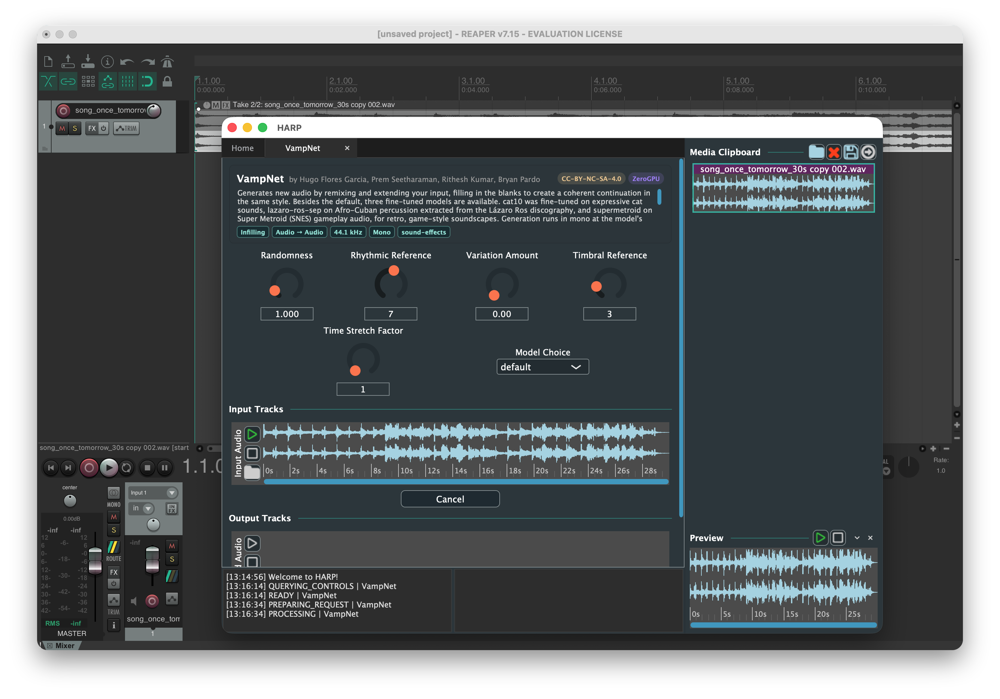
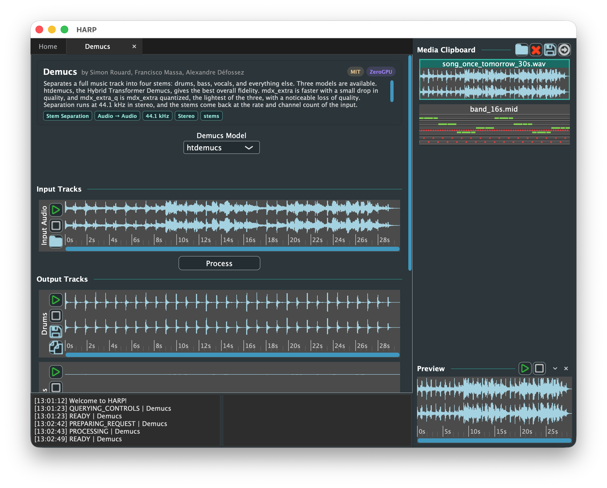
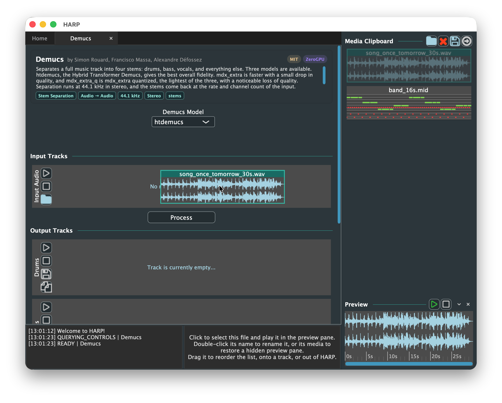

<!-- Our website (website/) expands each section of this README into a page of its own.
     The blocks between "#region" and "#endregion" markers are included verbatim by the website
     page that names them in an "@include" comment, so edit them here, and rename a region in
     both places at once. The website build fails if an included region is missing. -->

# HARP



<!-- -->
<!--[](https://app.netlify.com/sites/teamup-harp/deploys) -->
<!-- TODO: arXiv badge, once the HARP paper has a preprint to link. -->
<!--[](https://arxiv.org/abs/2503.02977) -->

<!-- #region overview -->
HARP is a sample editor for **h**osted, **a**synchronous, **r**emote **p**rocessing of audio and
MIDI with machine learning. It runs as a standalone application or as an external editor beside a
DAW. HARP sends the file you open, with the settings you choose, to a model hosted on a server, then
displays the result, ready to play or to send back to the DAW.

DAWs process audio with plugins, which run on the local CPU, within the real-time deadline of the
audio callback, and in a compiled format such as VST3, AU, or AAX. Many machine learning models for
audio cannot meet these requirements. They depend on a GPU, a specific Python environment, and
weights that can occupy several gigabytes, and their inference can take seconds or minutes. Porting
such a model to a plugin means reimplementing and optimizing it for real-time use, which falls
outside the scope of most research, and few models are ever made available inside a DAW.

HARP instead treats a model as a remote service. The model runs on hardware suited to it, whether a
[Hugging Face Space](https://huggingface.co/spaces), a server of your own, or the infrastructure of
a third-party API, and HARP communicates with it over HTTP, so the user needs no GPU or Python
environment. Requests run asynchronously, in a process separate from the DAW, so inference of any
duration blocks neither the DAW nor HARP's interface. Any DAW that supports an external sample
editor, such as [REAPER](https://www.reaper.fm), [Logic Pro](https://www.apple.com/logic-pro/), or
[Ableton Live](https://www.ableton.com/en/live/), can send audio to a model this way, and a
model deployed with [PyHARP](https://github.com/TEAMuP-dev/pyharp) is available to every user of
HARP as soon as it is online.
<!-- #endregion overview -->

## Table of Contents

* **[Installation](#installation)**
* **[Usage](#usage)**
* **[Contributing](#contributing)**
* **[Citations](#citations)**

Our website has the [full documentation](https://harp.tools/), including a walkthrough of
the interface and step-by-step tutorials on deploying a model of your own.

<!-- website/download/index.md -->
# Installation

Download a package for your platform from [harp.tools](https://harp.tools/download/), or
from the [latest release](https://github.com/TEAMuP-dev/HARP/releases) on GitHub. Every push is
built for each platform below.

<!-- #region install-requirements -->
- **macOS**: a universal binary, signed and notarized, for macOS 11 or newer on Apple silicon or
  Intel.
- **Windows**: an x64 executable, for Windows 10 or 11.
- **Linux**: x64 and arm64 archives, for glibc 2.35 or newer.

The Linux packages are built on the oldest supported Ubuntu, which sets that glibc requirement. They
run on Ubuntu 22.04, Debian 12, Fedora 36, RHEL 10, openSUSE Leap 16, and Arch, or anything newer.
At runtime HARP needs ALSA, FreeType, and X11, and loads libcurl for network requests, all of
which a desktop installation provides. Under Wayland it runs through XWayland, which GNOME and
KDE enable by default.

The Windows executable is not code signed, so Windows warns before running it the first time.
<!-- #endregion install-requirements -->

Our website has [instructions for each platform](https://harp.tools/download/), and
for [setting up HARP](https://harp.tools/setup/) with REAPER, Logic Pro, Pro Tools,
Ableton Live, Cubase, Audacity, FL Studio, and Adobe Audition.

<!-- website/setup/ and website/usage/ -->
# Usage

As a standalone application, open a file, open a model, process, and save the result. Within a DAW,
open the clip to process in HARP, process it, and either return the result with the
_Send-to-DAW_ icon of the media clipboard or write it to disk with the _Save_ icon.



## Warning

<!-- #region warning -->
**HARP is a _destructive_ file editor.** When running it standalone, use _Save As_ to avoid
overwriting the input. _Send-to-DAW_ overwrites the file from which the audio came. Working on a
duplicate, a bounce, or an alternate take leaves the original intact.

HARP processes the whole file a DAW passes it, so editing part of a clip means splitting it first,
then copying the excerpt into a file of its own, _e.g._, by bouncing it in place.
<!-- #endregion warning -->

## Workflow

<!-- #region workflow -->
- Open HARP, either standalone or from a DAW.
- On the `Home` tab, browse or search the models hosted by
  [TEAMuP on Hugging Face](https://huggingface.co/teamup-tech), which are grouped by function,
  or choose `Custom Path...` and supply the address of any HARP-compatible Gradio app, such as a
  Space (`owner/name`), a `gradio.live` link, or a local address (`http://localhost:7860`). A custom
  path keeps a card on the `Home` tab until it is removed with the X button on that card.
- Select a model to open it in a tab of its own. Several models can be open at once.
- Load audio or MIDI with the folder icon of an input track, or by dragging a file onto the track.
  An input marked `OPTIONAL` can be left empty.
- Set the controls, then select `Process`. While the model runs, the same button cancels it.
  Results appear in the output tracks as they arrive.
- Save the result with the `Save` icon of its track. To return it to the DAW, drag it into the
  media clipboard, select it there, and select the _Send-to-DAW_ icon.
<!-- #endregion workflow -->

### Tracks

<!-- #region tracks -->
- Click or drag within a track to move its playback position, during playback as well. The play
  icon becomes a pause icon while the track plays, and a paused track resumes where it stopped. The
  stop icon ends playback and returns to the start.
- Scroll over a track to zoom in time, or hold `Shift` while scrolling to pan. On a MIDI track,
  hold `Ctrl` (`Cmd` on macOS) while scrolling to zoom in pitch, or `Ctrl+Shift` to move through
  pitch.
- Drag a track onto another track, into the media clipboard, or out of HARP into a DAW.
- Save an output track with its `Save` icon, or copy it with its `Copy` icon and paste it into a DAW
  or a file browser.
- Labels that a model returns, such as beats or a key, appear over its output tracks. Hover over
  a label to read its description, and click one that has a link to open it.
<!-- #endregion tracks -->

### Media Clipboard

<!-- #region media-clipboard -->
The media clipboard holds tracks independently of any one model, so a result from one model can be
carried into another as its input. Show or hide it with `View > Media Clipboard`. It also opens on
its own when a file is added with `File > Open`.

- Add a file with the folder icon, or drag one in from a track or from a file browser.
- Select a track to play it in the preview pane beneath the list, which has its own play, pause, and
  stop icons. Drag the top edge of the pane to resize it, or minimize or close it from its title
  bar. `View > Preview Pane` shows it again, as does double-clicking the waveform or piano roll of
  a track.
- Double-click the name of a track to rename it.
- Drag a track up or down to reorder the list, or onto an input track of a model to use it there.
- Drag the left edge of the clipboard to change its width. HARP keeps the width of the clipboard and
  the height and state of the preview pane for the next session.
- When a DAW opened HARP with a file, the send icon overwrites that file with the selected track,
  which brings the result back into the DAW project.
<!-- #endregion media-clipboard -->



## API Keys

<!-- #region api-keys -->
Models hosted on Hugging Face run without an account. Those marked ZeroGPU draw on a small daily GPU
allowance, which a free [Hugging Face token](https://huggingface.co/settings/tokens) raises.
Stability AI models require a [Stability AI key](https://platform.stability.ai/account/keys), and
each request spends credits from that account. Add either under `File > Settings > API Keys`.

HARP sends each key only to the service that issued it, with one exception. An app at `localhost`
or `127.0.0.1` also receives your Hugging Face key, since HARP assumes that such an app runs on your
own computer. HARP never sends the key to a `gradio.live` link or to another computer on your
network.
<!-- #endregion api-keys -->

<!-- website/usage/models.md -->
## Models

Our website lists [highlights among the models we host](https://harp.tools/usage/models.html).

<!-- #region licenses -->
Each model is deployed under its original license, which HARP displays on a badge of its own beside
the model, so that the terms are apparent before the output is used. Authors who would rather their
model were not featured, or whose license we have stated incorrectly, are asked to
[open an issue](https://github.com/TEAMuP-dev/HARP/issues) so that we can correct or remove it
promptly.
<!-- #endregion licenses -->

<!-- website/contributing/ -->
# Contributing

There are two ways to contribute, depending on what you intend to build.

**To deploy a model for others to use in HARP**, begin with [pyharp](https://github.com/TEAMuP-dev/pyharp),
which wraps arbitrary Python code in a HARP-compatible Gradio app. Our website walks through
[deploying a model](https://harp.tools/pyharp/setup.html) from start to
finish, and our [deployment guidelines](https://github.com/TEAMuP-dev/HARP/blob/main/docs/DEPLOYMENT.md)
describe the conventions our own models follow: licensing, naming and tagging, sourcing weights,
reporting errors, preserving the input format, and choosing hardware.

<a href="https://github.com/TEAMuP-dev/pyharp">
  <picture>
    <source media="(prefers-color-scheme: dark)" srcset="https://github-stats-extended.vercel.app/api/pin/?username=TEAMuP-dev&repo=pyharp&theme=dark_github_repocard">
    
  </picture>
</a>

**To work on the application itself**, see [Building HARP](#building-harp) below, together with our
guidelines for [developing](https://github.com/TEAMuP-dev/HARP/blob/main/docs/DEVELOPING.md),
[reviewing](https://github.com/TEAMuP-dev/HARP/blob/main/docs/REVIEWING.md),
[code signing](https://github.com/TEAMuP-dev/HARP/blob/main/docs/SIGNING.md), and maintaining
[the website](https://github.com/TEAMuP-dev/HARP/blob/main/docs/WEBSITE.md). A service with an API
of its own, rather than a Gradio endpoint, is reached through a client class of its own, which our
guide to [adding an API provider](https://github.com/TEAMuP-dev/HARP/blob/main/docs/PROVIDERS.md)
describes.

<!-- #region version-compatibility -->
HARP 4.0.0 pairs with pyharp 0.4.2, and the two are released together. The root `VERSION` file
sets the application version through CMake.
<!-- #endregion version-compatibility -->

## Building HARP

<!-- #region build -->
The same commands build HARP on macOS, Windows, and Linux:

```bash
git clone --recurse-submodules https://github.com/TEAMuP-dev/HARP
cd HARP
cmake -B build -DCMAKE_BUILD_TYPE=Debug .
cmake --build build --config Debug --parallel
```

The build writes the binary to `build/HARP_artefacts/Debug/`, as `HARP.app` on macOS, `HARP.exe` on Windows,
and `HARP` on Linux. It accepts media files as arguments, and can be invoked from the command line:

```bash
./build/HARP_artefacts/Debug/HARP resources/media/test.wav resources/media/test.mid
```

Two platforms require additional steps. On macOS, `-DCMAKE_OSX_ARCHITECTURES` set to `arm64`, `x86_64`,
or `"arm64;x86_64"` selects the architecture, the last of these producing a universal binary. On
Linux, the
[JUCE dependencies](https://github.com/juce-framework/JUCE/blob/master/docs/Linux%20Dependencies.md)
must be installed first. There are no C++ unit tests, so a change is verified by running the
application.
<!-- #endregion build -->

## Debugging

<!-- #region debug -->
In [Visual Studio Code](https://code.visualstudio.com/), install Microsoft's C/C++ extension, then
add a configuration to `launch.json` pointing at the built binary, uncommenting the line for the
platform in use:

```json5
{
    "name": "Standalone HARP",
    "type": "cppdbg",
    "request": "launch",
    "program": "${workspaceFolder}/build/HARP_artefacts/Debug/HARP.app", // macOS
    //"program": "${workspaceFolder}/build/HARP_artefacts/Debug/HARP.exe", // Windows
    //"program": "${workspaceFolder}/build/HARP_artefacts/Debug/HARP", // Linux
    "args": ["../resources/media/test.wav", "../resources/media/test.mid"],
    "cwd": "${fileDirname}",
    "MIMode": "lldb" // macOS
}
```

An alternative configuration using `"request": "attach"` with `"processId": "${command:pickProcess}"`
attaches to an instance of HARP that is already running, such as one a DAW has launched.
<!-- #endregion debug -->

## Distribution

<!-- #region distribution -->
[GitHub Actions](https://github.com/TEAMuP-dev/HARP/blob/main/.github/workflows/build.yml) builds
and packages every push. Pushing a tag of the form `v*` also publishes a release, taking
`RELEASE.md` as its notes.

A macOS build can be packaged locally into a DMG with
[dmgbuild](https://github.com/dmgbuild/dmgbuild):

```bash
packaging/package.sh build/HARP_artefacts/Release/HARP.app HARP.dmg
```

Signing and notarizing that DMG in CI requires the `MACOS_CERTIFICATE` and
`MACOS_CERTIFICATE_PASSWORD` secrets for the signing certificate, and `APPLE_ID` with
`APPLE_APP_PASSWORD` for notarization.
[SIGNING.md](https://github.com/TEAMuP-dev/HARP/blob/main/docs/SIGNING.md) covers both, along with
signing a build on your own machine.
<!-- #endregion distribution -->

## Citations

<!-- #region citations -->
[NeurIPS 2025 Workshop on AI for Music Paper](https://openreview.net/pdf?id=Ha2z921r51):
```
@inproceedings{cwitkowitz2025harp,
    title     = {{HARP} 3.0: Generalizing {I/O} and {API} Support for Machine Learning in Digital Audio Workstations},
    author    = {Cwitkowitz, Frank and Benetatos, Christodoulos and Deng, Qixin and Yu, Huiran and Pruyne, Nathan and O'Reilly, Patrick and Garcia, Hugo Flores and Duan, Zhiyao and Pardo, Bryan},
    year      = 2025,
    booktitle = {NeurIPS AI for Music Workshop}
}
```

[ISMIR 2024 Late Breaking Demo](https://ismir2024program.ismir.net/lbd_497.html):
```
@article{benetatos2024harp,
    title     = {{HARP} 2.0: Expanding Hosted, Asynchronous, Remote Processing for Deep Learning in the {DAW}},
    author    = {Benetatos, Christodoulos and Cwitkowitz, Frank and Pruyne, Nathan and Garcia, Hugo Flores and O'Reilly, Patrick and Duan, Zhiyao and Pardo, Bryan},
    year      = 2024,
    journal   = {ISMIR Late Breaking Demo Papers}
}
```

[NeurIPS 2023 Workshop on Machine Learning for Creativity and Design Paper](https://neuripscreativityworkshop.github.io/2023/papers/ml4cd2023_paper23.pdf):
```
@inproceedings{garcia2023harp,
    title     = {{HARP}: Bringing Deep Learning to the {DAW} with Hosted, Asynchronous, Remote Processing},
    author    = {Garcia, Hugo Flores and O’Reilly, Patrick and Aguilar, Aldo and Pardo, Bryan and Benetatos, Christodoulos and Duan, Zhiyao},
    year      = 2023,
    booktitle = {NeurIPS Workshop on Machine Learning for Creativity and Design}
}
```
<!-- #endregion citations -->
